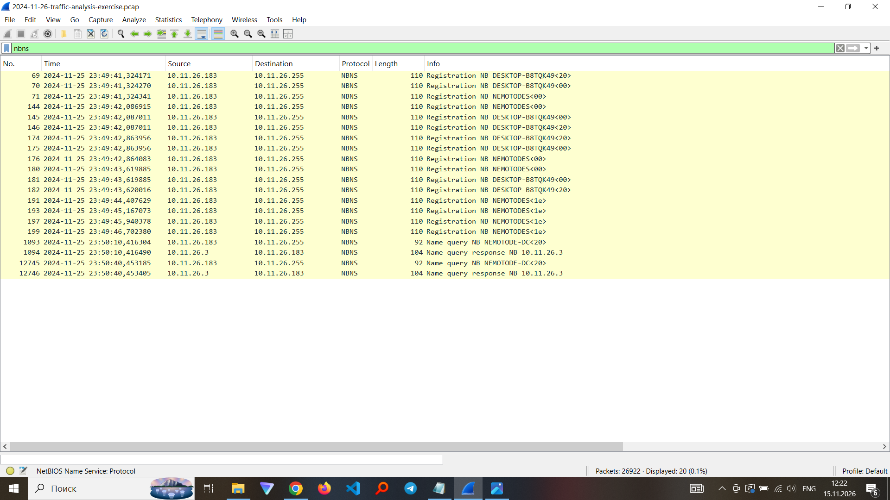
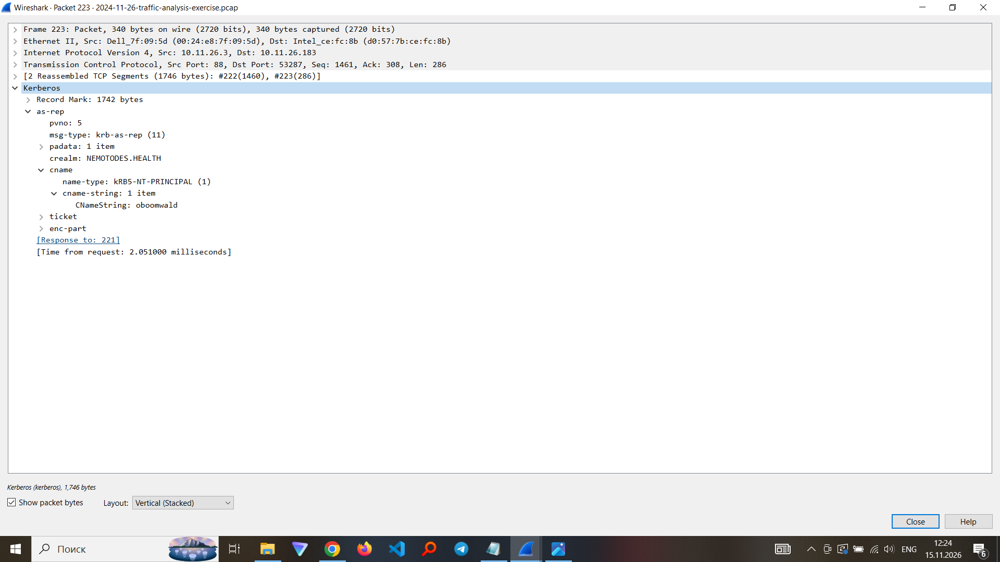
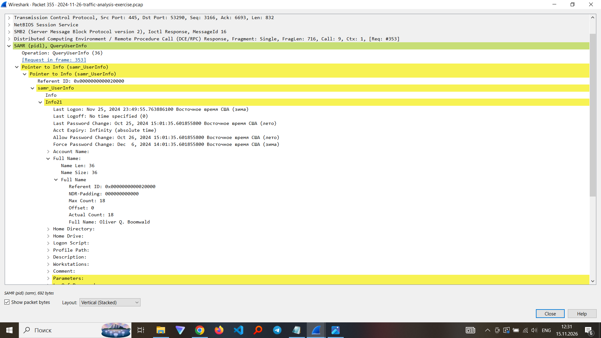
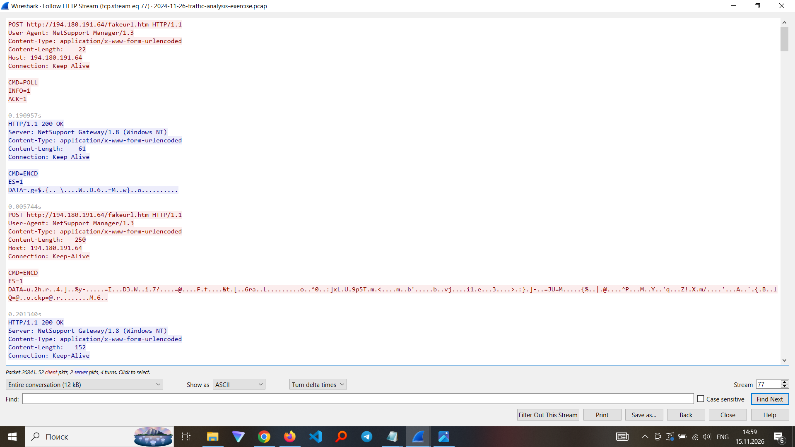
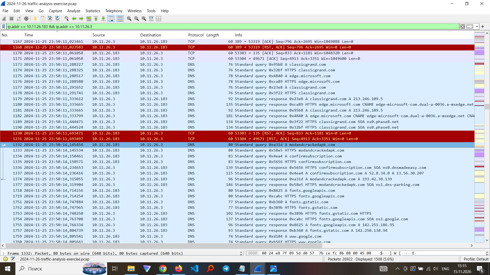
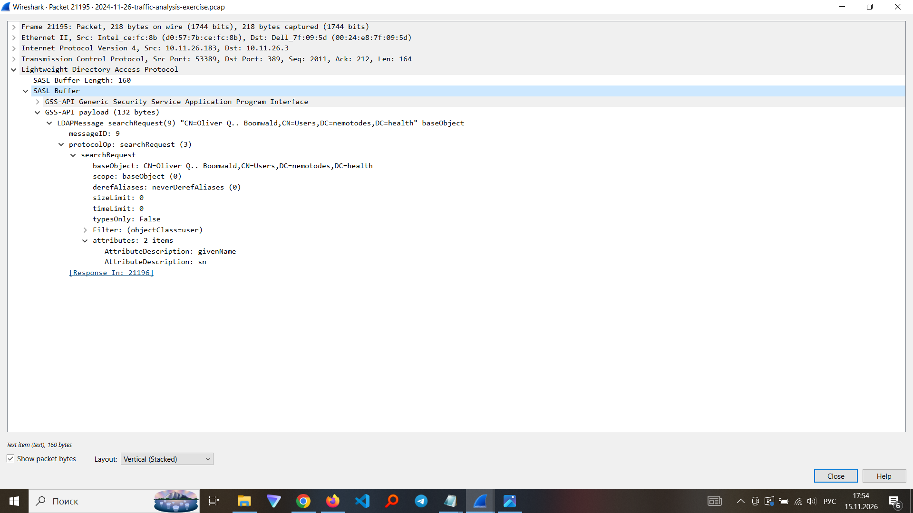
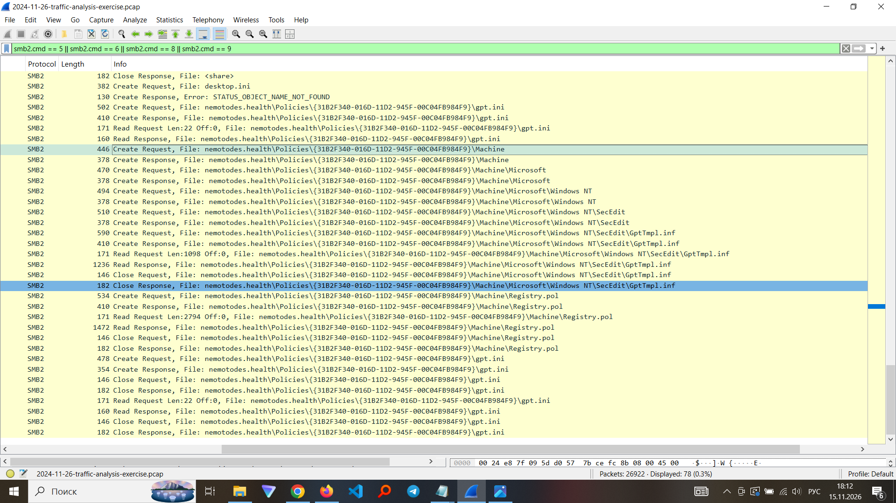
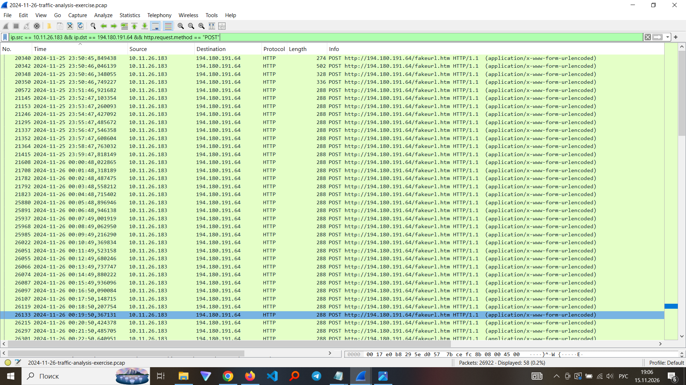
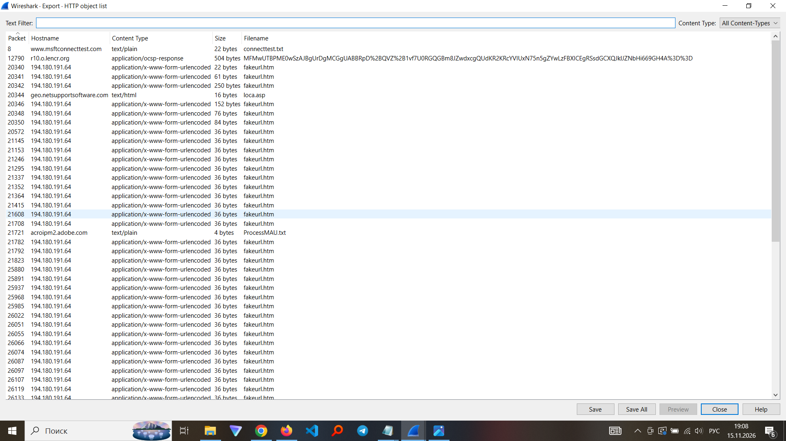
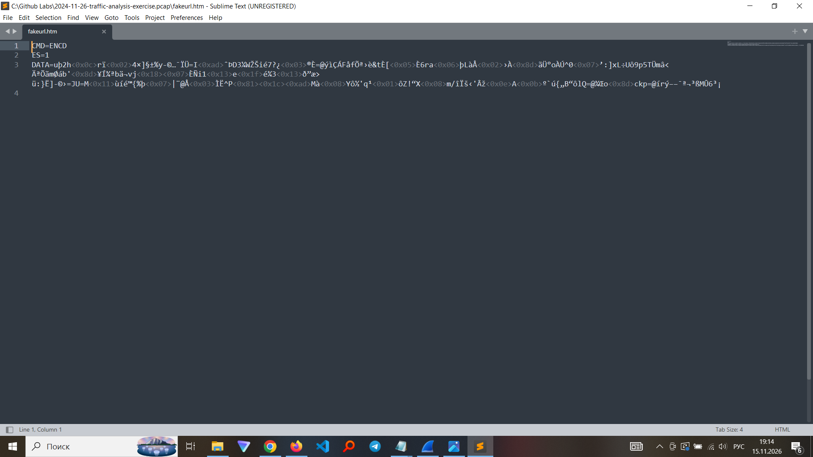

# Wireshark Investigation — NetSupport Remote Access Traffic

## Investigation Overview

This case study examines network activity recorded in `2024-11-26-traffic-analysis-exercise.pcap`.

The investigation focused on identifying the Windows host, examining directory-service traffic, and analyzing repeated HTTP communication associated with NetSupport remote administration software.

### Tools Used
- Wireshark
- Follow HTTP Stream
- Export HTTP Objects
- Protocol and display filters
- Sublime Text

## 1. Host Identification

NBNS traffic revealed a Windows workstation using the IP address `10.11.26.183`.

The hostname `DESKTOP-B8TQK49` was observed in NetBIOS name registration traffic.





## 2. User Account Investigation

SAMR traffic exposed account information, including the full name `Oliver Q. Boomwald`.

This information provides useful context for identifying the Windows environment. It does not independently establish which user initiated the suspicious HTTP activity.



## 3. NetSupport HTTP Communication

A significant finding was repeated HTTP communication involving the external IP address `194.180.191.64`.

The captured HTTP stream contained:

- `POST /fakeurl.htm`
- `User-Agent: NetSupport Manager/1.3`
- `Server: NetSupport Gateway/1.8 (Windows NT)`
- `CMD=POLL`
- `CMD=ENCD`
- `ES=1`
- `DATA=...`

The observed protocol fields are consistent with NetSupport remote administration communication.

The presence of encoded or binary-looking data prevents direct interpretation of the complete exchanged content.



## 4. DNS and Directory Services

DNS traffic was examined to provide context for network communications.



LDAP traffic also revealed queries involving the directory domain `nemotodes.dc.health`.

A captured LDAP request referenced the user `Oliver Q. Boomwald` and requested directory attributes including `givenName` and `sn`.



SMB activity was examined as additional context for the Windows environment.



These observations provide environmental context but do not independently prove malicious activity.

## 5. Repeated HTTP Requests

Filtering the capture revealed numerous HTTP requests to `194.180.191.64`, including repeated interactions with `/fakeurl.htm`.

The repetition and NetSupport-specific protocol fields suggest an ongoing remote administration session or polling mechanism.



## 6. HTTP Object Extraction

Wireshark's Export HTTP Objects feature was used to inspect the HTTP content associated with the communication.

Multiple objects were listed under `fakeurl.htm`, with different response sizes.



One exported object contained fields resembling:

```text
CMD=ENCD
ES=1
DATA=<binary data>
```

The content was not ordinary HTML despite the `.htm` filename.



The underlying binary content was not successfully decoded during this investigation. Therefore, its exact purpose remains undetermined.

## 7. Network Indicators

| Indicator | Value | Context |
|---|---|---|
| Internal host | `10.11.26.183` | Investigated Windows workstation |
| Hostname | `DESKTOP-B8TQK49` | NBNS registration |
| External IP | `194.180.191.64` | NetSupport-associated HTTP communication |
| HTTP path | `/fakeurl.htm` | Repeated POST requests |
| User-Agent | `NetSupport Manager/1.3` | Client identification string |
| Server header | `NetSupport Gateway/1.8` | Remote endpoint identification |
| Protocol fields | `CMD=POLL`, `CMD=ENCD` | Remote administration communication |

These are investigation indicators, not independently validated malicious indicators of compromise.

## 8. MITRE ATT&CK Considerations

The observed communication is potentially relevant to:

- **T1219 — Remote Access Software:** NetSupport is a remote administration tool that can be used legitimately or abused by attackers.
- **T1071.001 — Web Protocols:** HTTP was used to transport NetSupport-related communication.

These mappings describe potentially relevant techniques. The available network evidence does not establish unauthorized access or confirmed attacker control.

## 9. Investigation Limitations

This investigation was based on packet capture evidence.

The analysis did not establish:

- Whether NetSupport was installed with authorization
- Whether a remote operator performed malicious actions
- The decoded meaning of the `CMD=ENCD` payload
- Whether malware was installed or executed
- Whether files or credentials were exfiltrated

Endpoint telemetry, process execution records, and authorized software inventories would be required to strengthen these conclusions.

## Conclusion

The investigation identified a Windows workstation communicating with an external NetSupport-associated HTTP endpoint.

Repeated POST requests, polling commands, encoded response data, and NetSupport-specific headers provide strong evidence of remote administration protocol activity.

However, NetSupport is dual-use software. The captured traffic alone is insufficient to conclude that the workstation was compromised.

This case demonstrates practical skills in network traffic analysis, host identification, Windows protocol inspection, HTTP stream reconstruction, and evidence-based incident reporting.
